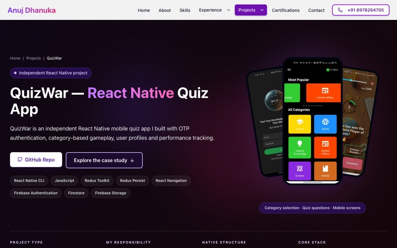
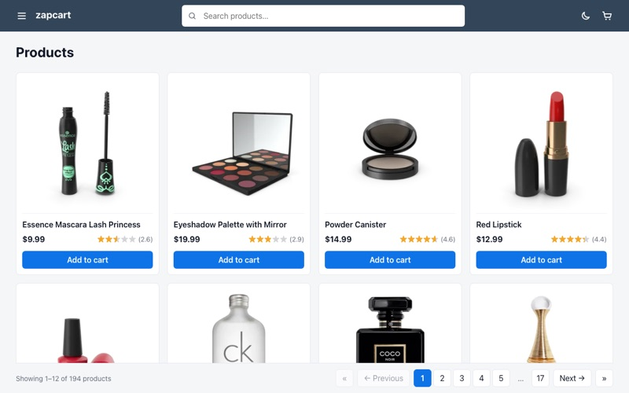
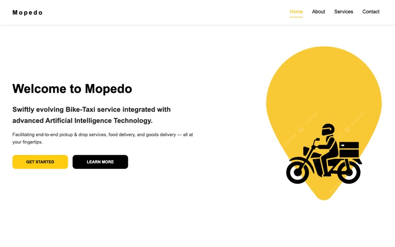
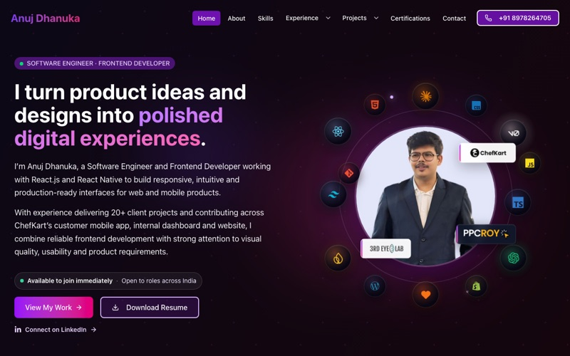

  
  
  
  

### About me

I'm **Anuj Dhanuka**, a **Frontend & React Native Developer**. I build responsive web and mobile product interfaces with React, React Native, Next.js and TypeScript.

- Most recently at **ChefKart** (Dec 2025 – Oct 2026): customer app, website, payment flows and internal operations dashboard. **#1 contributor** to both the app and the website. The code is private, so the work is written up as a [case study](https://anujdhanuka.com/experience/chefkart).
- Before that, **20+ client websites** at PPCROY across React, WordPress, Shopify and Webflow.
- Based in Vizianagaram, India · open to frontend and React Native roles across India.

### Featured work

<table>
  <tr>
    <td width="50%" valign="top">
      
      <h4>QuizWar</h4>
      React Native quiz app with OTP sign-in, Firebase and Redux Toolkit.  
      <a href="https://anujdhanuka.com/projects/quizwar">Case study</a> · <a href="https://github.com/Anuj-Dhanuka/QuizWar">Code</a>
    </td>
    <td width="50%" valign="top">
      
      <h4>ZapCart</h4>
      React + TypeScript product listing with filters, search and pagination.  
      <a href="https://zapcart-anuj.netlify.app/">Live</a> · <a href="https://github.com/Anuj-Dhanuka/zapcart">Code</a>
    </td>
  </tr>
  <tr>
    <td width="50%" valign="top">
      
      <h4>Mopedo</h4>
      Responsive React web app for a bike-taxi and delivery service.  
      <a href="https://mopedo.netlify.app/">Live</a> · <a href="https://anujdhanuka.com/projects/mopedo">Case study</a> · <a href="https://github.com/Anuj-Dhanuka/mopedo-web-app">Code</a>
    </td>
    <td width="50%" valign="top">
      
      <h4>Portfolio</h4>
      Next.js 16 and TypeScript site with case studies, 90+ mobile PageSpeed.  
      <a href="https://anujdhanuka.com">Site</a> · <a href="https://github.com/Anuj-Dhanuka/Anuj-dhanuka-portfolio-v3">Code</a>
    </td>
  </tr>
</table>

### Experience

| Company | Role | Period | |
| --- | --- | --- | --- |
| **ChefKart** | Associate Software Engineer | Dec 2025 – Oct 2026 | [Case study](https://anujdhanuka.com/experience/chefkart) |
| **PPCROY TECH SOLUTIONS** | Associate Full Stack Developer | Oct 2024 – Dec 2025 | [Case study](https://anujdhanuka.com/experience/ppcroy) |
| **3rd Eye Lab** | Associate Software Engineer Intern | Apr – Jun 2024 | [Case study](https://anujdhanuka.com/experience/third-eye-lab) |

### Stack

  
   Also React Native · Redux Toolkit · REST APIs · Shopify

